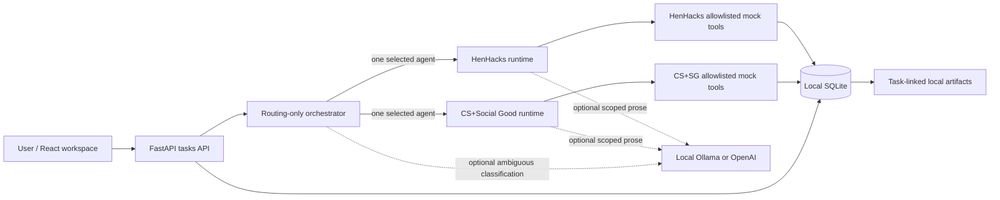

# ZANE

**A local-first, approval-aware personal agent workspace with strict domain boundaries.**

ZANE helps two student-organization workflows without giving a single assistant
access to everything. It routes a request to one specialist, loads only that
specialist's active skill and permitted tools, records a concise execution
trace, and pauses before changing data. It runs with realistic local demo data
and **no API key**.

## Why ZANE?

Large general-purpose agents can accumulate unrelated instructions, private
context, and tool permissions. ZANE addresses this by separating routing from
execution: its orchestrator knows compact capability summaries, while
HenHacks and CS+Social Good have isolated manifests, skills, tools, and
namespaced memory.



**Skills vs. tools:** skills are separately loadable workflow instructions;
tools are executable operations. A task loads one skill. The registry checks
the agent, skill, tool, and read/write permission at invocation **and again at
approval**. Email/doc text is untrusted reference data, never system
instructions. No send-email or send-Discord tool exists.

**Human in the loop:** read-only queries complete automatically. Label
updates, sponsor tracker changes, and creation of email/Discord drafts or
meeting minutes require approval. Task states include `PROPOSED`,
`AWAITING_CLARIFICATION`, `AWAITING_APPROVAL`, `APPROVED`, `EXECUTING`,
`COMPLETED`, `FAILED`, and `REJECTED`. A clarification reply resumes the
**original task** after refresh or server restart. Events show routing, the
active skill, safe tool summaries, approval, artifact creation, and errors; no
hidden reasoning or raw private source documents appear in traces.

## What the two agents do

| Agent | Skills | Mock operations |
| --- | --- | --- |
| HenHacks | Sponsor email triage, follow-up, response drafting, sponsorship status, perk tracking | Search/read seeded sponsor threads; label threads, update tracker, create **unsent** email drafts after approval |
| CS+Social Good | Meeting minutes, agenda, action items, project status, Discord check-in draft | Read seeded minutes/updates/actions; write minutes and create **unposted** Discord drafts after approval |

Local ZANE artifacts are saved in SQLite. Approved email drafts, meeting
minutes, and Discord drafts become artifacts only after approval; read-only
meeting agendas and sponsorship/project summaries save automatically. Open
the **Artifacts** view to read, copy, or export `.md` content with the
originating task and agent. These are **not Google Docs**. Future export
destinations could consume the same artifact record without changing a
domain workflow.

## Screenshots

> Replace these placeholders with screenshots captured from your local demo:
> workspace and execution trace; clarification and approval; artifact viewer.

## Run locally

Requires Python 3.12+ (3.12 target), Node.js compatible with Vite 8
(20.19+ or 22.12+), and npm. No cloud service is required.

### Windows PowerShell

From the repository root:

```powershell
python -m venv backend\.venv
& backend\.venv\Scripts\python.exe -m pip install -e 'backend[test]'
Copy-Item .env.example .env
& backend\.venv\Scripts\python.exe -m uvicorn app.main:app --app-dir backend --reload
```

### macOS / Linux

```sh
python3 -m venv backend/.venv
backend/.venv/bin/python -m pip install -e 'backend[test]'
cp .env.example .env
backend/.venv/bin/python -m uvicorn app.main:app --app-dir backend --reload
```

In another terminal on any platform:

```sh
cd frontend
npm ci
npm run dev
```

Open `http://localhost:5173`. Vite proxies `/api` to port 8000. The default
SQLite database is `backend/zane.db` when started from the repository root.
Fixture JSON is immutable seed data; demo mutations update SQLite only.
`.env` is optional for model-free operation and should never be committed.

### Optional Ollama intelligence

ZANE **does not install, start, or download** Ollama or its models. If you
already run Ollama locally and have a model available, set in your local `.env`:

```dotenv
ZANE_MODEL_PROVIDER=ollama
ZANE_OLLAMA_BASE_URL=http://localhost:11434
ZANE_OLLAMA_MODEL=llama3.2
```

Ollama may help with ambiguous routing and scoped draft/summary prose. If it
is unavailable or produces unusable text, deterministic content remains the
fallback and an execution event notes it. Routing rules, tool selection,
approval and data eligibility remain deterministic. `ZANE_MODEL_PROVIDER=none`
is the default. The existing optional OpenAI adapter remains available via
`ZANE_MODEL_PROVIDER=openai`, `OPENAI_API_KEY`, and `ZANE_OPENAI_MODEL`; API
keys are never passed to agents.

## Demo Mode walkthrough

1. Try the clickable HenHacks example for a follow-up, or request
   `Draft follow-ups for HenHacks sponsors who haven't responded`. Select a
   sponsor when prompted. Reload before replying to demonstrate persistence.
2. Review the selected agent, active skill, safe trace, and approval card.
   Approve a draft; open **Artifacts** to view, copy and download its `.md`.
3. Try a CS+Social Good agenda or minutes, then compare the capability
   viewer's separate tool/skill lists.
4. Use **Reset Demo Data** and explicitly confirm to clear tasks, traces,
   memory and artifacts and restore SQLite demo records from immutable
   fixture files. This is destructive for local demo data.

## Tests

```powershell
& backend\.venv\Scripts\python.exe -m pytest backend\tests
```

On macOS/Linux use `backend/.venv/bin/python -m pytest backend/tests`.
For the frontend:

```sh
cd frontend
npm run typecheck
npm run build
```

## Security boundaries and limitations

ZANE is a **single-user local demo**, not an authenticated multi-user service;
do not expose the development server publicly. SQLite artifacts can contain
private user text and are not encrypted. Approval controls mock local writes,
not external services. There is no Gmail, Google OAuth/Docs, real Discord API,
voice, vector database, knowledge graph, cloud deployment, or autonomous
recursive agent. Optional model output is untrusted prose, not permission
authority. See [architecture](docs/architecture.md) and
[development notes](docs/development.md).

## Roadmap

Possible later work includes authenticated storage, additional artifact export
destinations, and carefully permissioned external integrations. These are
**not implemented** in this submission.

## Built with GitHub Copilot

GitHub Copilot was used to inspect and design the boundaries, scaffold the
FastAPI/React MVP, iterate on approval and clarification lifecycles, add tests
for isolation and persisted artifacts, refine the interface and documentation,
and verify the local experience. Human review and test execution remain part
of the development workflow.
